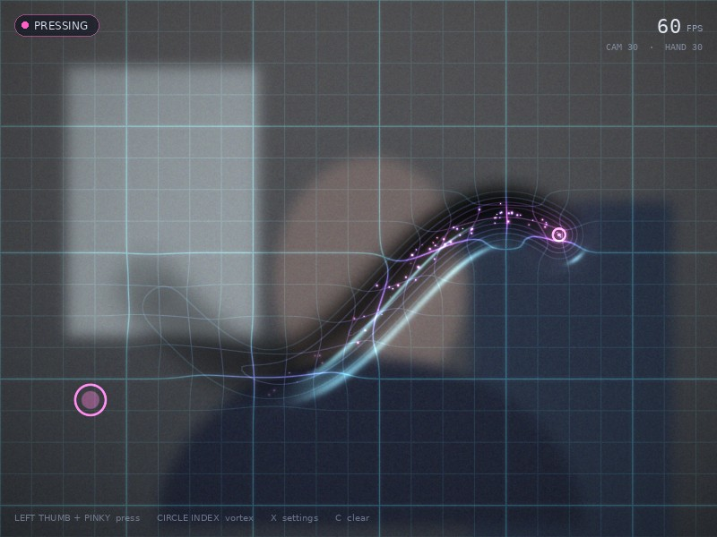
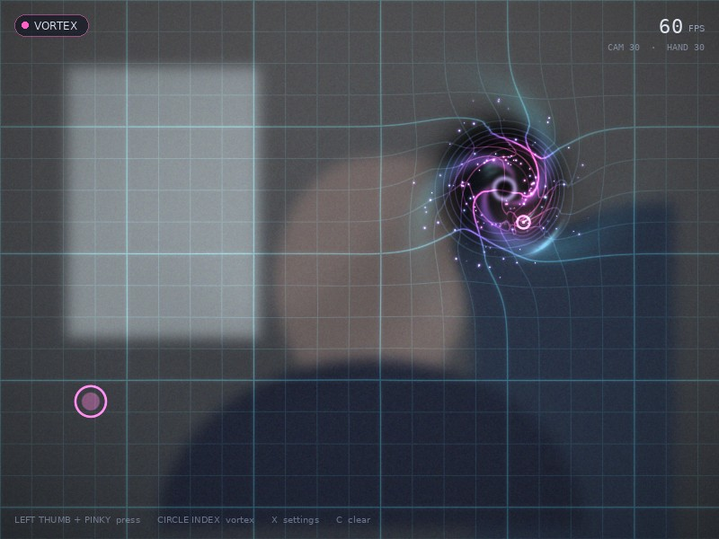

# Spacetime Canvas

Press into a glowing elastic grid with your fingertip. Hold your left thumb against your left pinky, and your right index finger pushes a dent into the screen, the way a heavy ball sinks into a stretched rubber sheet. Draw circles with your fingertip and a whirlpool starts spinning at that spot.

| Pressing a groove | Spinning a vortex |
| --- | --- |
|  |  |

*These images were rendered off-screen with a placeholder background. When the app runs, your webcam feed takes its place.*

---

## 1. Install and run

### Requirements

- Windows 10/11, macOS or Linux
- Python **3.10, 3.11 or 3.12** (64-bit)
- A webcam
- A graphics card or integrated GPU with OpenGL 3.3 (anything from the last ten years)

### Setup

```bash
# 1. Open a terminal in the project folder
cd AI_computer_vision_drawing_special_mode

# 2. Create and activate a virtual environment
python -m venv .venv
# Windows
.venv\Scripts\activate
# macOS / Linux
source .venv/bin/activate

# 3. Install the dependencies
pip install -r requirements.txt

# 4. Run
python main.py
```

The first launch downloads the MediaPipe hand model (about 8 MB) into `models/`. After that the app works offline.

### Controls

| Action | How |
| --- | --- |
| Press into the fabric | Touch your **left thumb** to your **left pinky** and hold. Your **right index fingertip** is the pen. |
| Create a vortex | While pressing, draw small circles with the right index finger. The whirlpool spins the same way your finger turns. |
| Lift the pen | Separate your left thumb and pinky. Grooves spring back on their own after a few seconds. |
| Press without the left hand | Hold `Space` |
| Draw with the mouse | Hold the left mouse button and drag (useful without a camera) |
| Camera settings | `X` opens a separate settings window. Press `X` again to close it. |
| Clear everything | `C` |
| Toggle hand skeleton | `H` |
| Toggle grid | `G` |
| Quit | `Esc` or `Q` |

The frame rate is shown in the top-right corner, with the camera and hand-tracking rates underneath.

### Getting a good frame rate

The app aims for 30 to 60 FPS and warns you on screen if the camera or the hand tracker falls below 15 FPS. If that happens, press `X` and:

1. Choose **640 x 480**. Hand tracking does not need more detail than that.
2. Keep **MJPG stream** ticked. Most USB webcams only reach 60 FPS in MJPG mode.
3. Turn **Auto exposure** off in a dim room. Auto exposure often lengthens the shutter time, which lowers the camera's FPS to 15 or less.
4. On Windows, try the other **Backend** (DirectShow or Media Foundation) if the camera will not open or feels slow.

---

## 2. Tech stack

| Part | Library | Why this one |
| --- | --- | --- |
| Webcam capture | **OpenCV** (`opencv-python`) | Reliable cross-platform camera access, control over resolution, FPS and codec |
| Hand tracking | **MediaPipe Hand Landmarker** (Tasks API) | 21 landmarks per hand in real time on a CPU, plus left/right labels |
| Maths and simulation | **NumPy** | Vectorised spring simulation and particle system |
| Rendering | **ModernGL** + **GLSL shaders** | All the per-pixel work (warping, lighting, grid, glow) runs on the GPU |
| Window and input | **GLFW** (`glfw`) | Lightweight OpenGL window with keyboard and mouse input |
| On-screen text | **Pillow** | Renders the HUD text into a transparent image |
| Settings window | **Tkinter** (built into Python) | A separate native window, no extra install |
| Tests | **pytest** (optional) | Checks the gesture and physics logic without a camera or GPU |

---

## 3. How it works (for everyone)

Imagine the screen is a **trampoline** with a neon grid printed on it, and the camera image is painted onto that trampoline.

1. **The camera watches your hands.** A small AI model finds 21 points on each hand (the knuckles and fingertips) many times per second.
2. **Your left hand is the "press" button.** When the tip of your thumb touches the tip of your pinky, the app knows you want to push. Letting go lifts the pen.
3. **Your right index finger is the pen.** Wherever it is, the trampoline gets pushed down. Moving the finger drags a groove across the surface.
4. **The surface is elastic.** Like real rubber, the groove slowly fills back in over a few seconds. The grid lines bend into the dent and glow more strongly the deeper it is, so you can read the depth at a glance.
5. **Circles become whirlpools.** If your fingertip keeps moving in a circle, the app measures how fast and in which direction it turns. It then twists the surface around that point, like water swirling down a drain, and releases glowing dust that spirals into the centre. When you stop, the whirlpool keeps turning for a moment and then calms down.
6. **Everything is redrawn around 60 times per second,** so the effect feels instant.

No images or video are stored or sent anywhere. Everything happens on your own computer.

---

## 4. How it works (technical)

### 4.1 Pipeline

```
 camera thread            tracker thread                 main thread (GLFW + ModernGL)
 ─────────────            ──────────────                 ─────────────────────────────
 cv2.VideoCapture  ──►  newest frame ──► MediaPipe  ──►  hands ──► Scene.update(dt)
 (mirror, EMA fps)       (downscaled to ≤640 px wide)        │        ├─ PinchDetector (left)
                                                              │        ├─ OneEuroFilter (right index)
                                                              │        ├─ SpinDetector → VortexField
                                                              │        ├─ Fabric.press / step
                                                              │        └─ ParticleSystem
                                                              ▼
                                                    Renderer: fabric.frag → particles → skeleton → HUD
                                                              ▲
                                                    Tk settings window pumped once per frame
```

- Capture, detection and rendering run on three threads. Each stage only ever reads the **newest** result of the previous one, so a slow stage drops frames instead of building up latency.
- The tracker publishes the frame **together with** the landmarks found in it, so the video and the overlays always match.
- The simulation runs on the render clock (vsync), not the camera clock. The fabric and vortices stay smooth even when the camera delivers 30 FPS.

### 4.2 Coordinates

Frames are mirrored before detection, so MediaPipe's handedness labels match the user's real hands (the model assumes a selfie image; the labels are swapped when mirroring is turned off). Landmarks are normalised to the camera image. They are mapped to the 800 x 600 logical canvas with the same "cover" crop that the shader uses for the camera texture:

```
uv_canvas = 0.5 + (uv_camera - 0.5) / crop_scale
crop_scale = (canvas_aspect / camera_aspect, 1)   if the camera is wider than 4:3
```

All gameplay distances (brush size, vortex radius, spin radius) are in canvas pixels, so they do not depend on the window size or camera resolution.

### 4.3 Gestures (`app/gestures.py`)

- **Pinch with hysteresis.** `ratio = |thumb_tip − pinky_tip| / |wrist − middle_mcp|`. Dividing by palm length makes the test independent of distance to the camera. The pen goes down below `0.42` and only lifts above `0.60`, which removes flicker at the boundary.
- **One Euro filter** on the index fingertip. The cutoff frequency grows with speed: heavy smoothing when the finger is still, little lag when it moves fast.
- **Spin detection.** The last 0.75 s of pen positions are kept. Around their centroid the detector computes the wrapped angle steps `Δθ` and requires:
  - a mean radius between 10 and 150 px, with a standard deviation below 45% of the mean (round, not a zig-zag);
  - `|ΣΔθ| ≥ 1.5π` (at least three quarters of a turn);
  - `|ΣΔθ| ≥ 0.7 · Σ|Δθ|` (mostly one direction).

  The signed angular speed `ΣΔθ / (2π · duration)` becomes the target spin of the vortex. Screen y points down, so a positive value means clockwise.

### 4.4 Elastic fabric (`app/fabric.py`)

The fabric is a 200 x 150 height grid (one cell = 4 x 4 canvas px) simulated as coupled damped springs with the border pinned at zero:

```
v += (c_n · ∇²h − k · h) · Δt
v *= exp(−c · Δt)
h += v · Δt                         fixed sub-steps of 1/120 s
```

`k` and `c` come from the "Recovery time" setting. With damping ratio `ζ = 1.15` the slow decay rate is `ω₀(ζ − √(ζ² − 1))`, and `ω₀` is chosen so three time constants fit in the requested time, which leaves the groove about 95% flat. The Laplacian term spreads the dent to its neighbours, giving the rubber-sheet feel.

The pen carves a capsule (segment from last to current position) with a Gaussian profile. Cells are only pushed down (`min`), and their velocity is zeroed while the pen holds them.

### 4.5 Vortices (`app/vortex.py`)

Each vortex stores a centre, radius and signed spin (turns/s). While the finger circles, the spin follows the measured speed with a 0.35 s time constant. Reversing direction first has to cancel the existing spin. Without new input the spin decays with `exp(−t / τ)` ("Vortex fade" setting) and the vortex is removed once it is too weak to see. Up to six vortices exist at once; the weakest one is recycled.

### 4.6 Particles (`app/particles.py`)

The particles are a fixed pool of 3000 stored as NumPy arrays; dead slots are reused. Each vortex spawns dust on its rim at a rate proportional to its strength. Dust moves with a whirlpool-like angular speed `ω(r) ∝ R² / (r² + (0.35R)²)`, capped at the core and faded far away, plus a small inward pull. The rotation is applied as an exact rotation of the offset vector. A plain tangent step (explicit Euler) would slowly push particles outward. The pen also sheds short-lived sparks that inherit part of its velocity.

### 4.7 Rendering (`app/renderer.py`, `app/shaders/`)

One full-screen fragment shader (`fabric.frag`) does most of the work:

1. **Depth** `h = height_texture + Σ vortex funnels`, and its gradient by central differences.
2. **Lens pull.** The sample position moves along the gradient, so content appears to slide into the pit.
3. **Twist.** Around each vortex the sample position is rotated by `−strength · 2.4 · exp(−r² / 0.55R²)`.
4. **Camera grade** (brightness, contrast, saturation, cool tint, dimming), then Lambert lighting from a normal built from the gradient, and darkening with depth.
5. **Grid.** Minor, major and halo lines drawn in the warped space with `fwidth` anti-aliasing. Line brightness and colour (cyan → violet → magenta) follow the depth. Iso-depth contour rings appear only inside dents.
6. **Vortex glow.** Logarithmic spiral arms `cos(3(θ − phase) ± 4.2·ln(r/R))` that trail the rotation, a dark core and a thin bright ring.
7. **Reticles** for the pen and for the left-hand pinch (an arc that fills as thumb and pinky close), then a vignette and light film grain.

Particles and hand joints are point sprites with additive blending. The skeleton uses `GL_LINES`. The HUD is a Pillow-rendered RGBA texture that is redrawn only when its text changes.

### 4.8 Performance budget

| Stage | Typical cost |
| --- | --- |
| MediaPipe (2 hands, 640 px wide, CPU) | 10 to 25 ms, on its own thread |
| Fabric step (NumPy) | ~0.4 ms per frame |
| Particles (up to 3000) | ~1 ms per frame |
| Shader pass at 800 x 600 | well under 1 ms on any recent GPU |

### 4.9 Project layout

```
main.py                   entry point
app/
  app.py                  window, main loop, keyboard and mouse
  config.py               constants and the shared Settings object
  camera.py               threaded webcam capture
  hand_tracker.py         threaded MediaPipe hand landmarker
  gestures.py             One Euro filter, pinch and spin detection
  scene.py                game logic: hands -> pen, fabric, vortices, particles
  fabric.py               elastic height-field simulation
  vortex.py               vortex model
  particles.py            particle pool
  renderer.py             ModernGL resources and draw calls
  hud.py                  on-screen text
  settings_window.py      Tk camera settings window
  shaders/                GLSL shaders
tests/test_logic.py       tests that need no camera or GPU
docs/                     README images
```

### 4.10 Tests

```bash
pip install pytest
python -m pytest -q
```

The tests cover spin direction and rejection of zig-zags, pinch hysteresis, jitter reduction, groove recovery without overshoot, vortex spin-up and fade, particles spiralling inward, the camera-to-canvas crop mapping, and a full `Scene` update with a synthetic left-hand pinch.

---

## 5. Troubleshooting

| Problem | Fix |
| --- | --- |
| `Cannot open camera 0` | Close other apps using the webcam, pick another camera index or backend in the settings window (`X`). |
| Hand tracking disabled / model download fails | Download `hand_landmarker.task` manually from the URL in `app/config.py` and place it in `models/`. |
| Window opens but stays black | Update your graphics driver; the app needs OpenGL 3.3. |
| FPS below 15 | See "Getting a good frame rate" above. |
| Both hands get the same label | The app falls back to screen position: the hand further right is the pen. Keep both hands clearly apart. |
